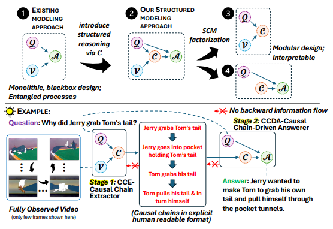

<div align="center">

<h1> ChainReaction: Causal Chain-Guided Reasoning for Modular and Explainable
Causal-Why Video Question Answering</h1>

<h5 align="center"> If you find this project useful, please give us a star🌟.

<h5 align="center"> 

<a href='https://arxiv.org/abs/2508.21010'></a>


[Paritosh Parmar](https://paritoshparmar.github.io/)<sup>1,2</sup>,
[Eric Peh]()<sup>1,2</sup>,
[Basura Fernando](https://basurafernando.github.io/)<sup>1,2,3</sup>,


<sup>1</sup>[
Institute of High Performance Computing, Agency for Science, Technology and Research, Singapore](https://www.a-star.edu.sg/ihpc), 
<sup>2</sup>[Centre for Frontier AI Research, Agency for Science, Technology and Research, Singapore](https://www.a-star.edu.sg/cfar),
<sup>3</sup>[College of Computing and Data Science, Nanyang Technological University, Singapore](https://www.ntu.edu.sg/computing)

</h5>
</div>

## News
- [ ] Pre-process and training code 
- [ ] Code release to generate own Causal Chains
- [x] Causal Chains Release
- [x] **`24 Dec 2025`** We release our paper on [arxiv](https://arxiv.org/pdf/2508.21010).

## Abstract
Existing Causal-Why Video Question Answering (VideoQA) models often struggle with higher-order reasoning, relying on opaque, monolithic pipelines that entangle video understanding, causal inference, and answer generation. These black-box approaches offer limited interpretability and tend to depend on shallow heuristics. We propose a novel, modular paradigm that explicitly decouples causal reasoning from answer generation, introducing natural language causal chains as interpretable intermediate representations. Inspired by human cognitive models, these structured cause-effect sequences bridge low-level video content with high-level causal reasoning, enabling transparent and logically coherent inference. Our two-stage architecture comprises a Causal Chain Extractor (CCE) that generates causal chains from video-question pairs, and a Causal Chain-Driven Answerer (CCDA) that derives answers grounded in these chains. To address the lack of annotated reasoning traces, we introduce a scalable method for generating accurate causal chains from existing datasets. We construct human verified causal chains for 46K samples. We also propose CauCo, a new evaluation metric for causality-oriented captioning. Experiments on three large-scale benchmarks demonstrate that our approach not only outperforms state-of-the-art models, but also yields substantial gains in explainability, user trust, and generalization -- positioning the CCE as a reusable causal reasoning engine across diverse domains.

<div align=center>

</div>

## Citation
We appreciate your citations if you find our paper related and useful to your research!
```
@article{parmar2025chainreaction,
  title={ChainReaction! Structured Approach with Causal Chains as Intermediate Representations for Improved and Explainable Causal Video Question Answering},
  author={Parmar, Paritosh and Peh, Eric and Fernando, Basura},
  journal={arXiv preprint arXiv:2508.21010},
  year={2025}
}
```


